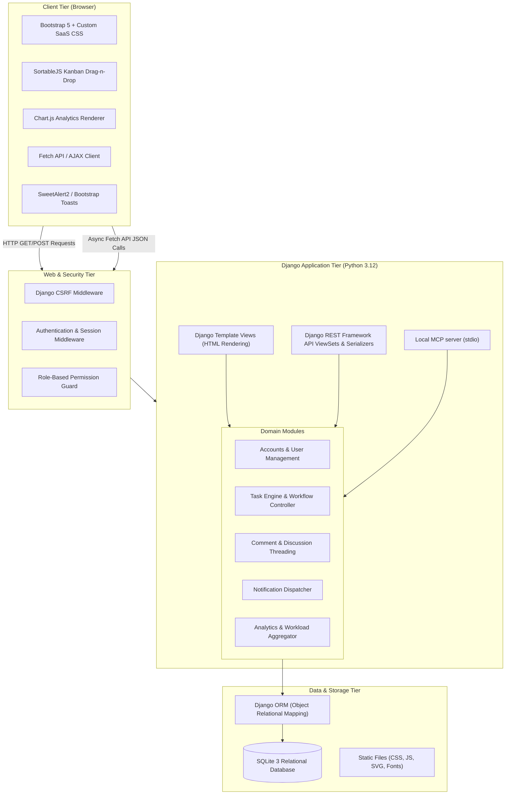
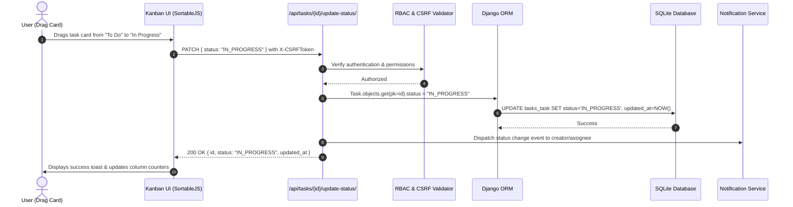
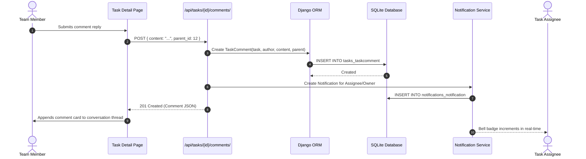

# TaskFlow - System Architecture

## 1. Architectural Overview
TaskFlow is built as a hybrid modern SaaS web application. It combines Django's robust server-side rendered (SSR) templates for core layout scaffolding, SEO, and fast initial paint with a Django REST Framework (DRF) JSON API and JavaScript (Fetch API + DOM manipulation) layer for fluid, reactive experiences (such as Kanban drag-and-drop, real-time comment insertion, and notification polling).

---

## 2. Component Breakdown

### 2.1 Client-Side Presentation
- **Bootstrap 5.3 & Custom Theme:** Customized with a SaaS dark/light palette, refined border radiuses, crisp typography (`Inter`), and modern elevation shadows.
- **Interactive Modules:**
  - `kanban.js`: Powered by SortableJS, triggers REST PATCH calls to `/api/tasks/{id}/update-status/` with roll-back state management on failure.
  - `comments.js`: Submits threaded comments via Fetch API, updating the DOM dynamically without page refresh.
  - `notifications.js`: Periodically syncs notification count and renders unread items inside the top navigation drawer.
  - `analytics.js`: Renders dynamic status, priority, and workload charts using Chart.js.

### 2.2 Security & Authentication Pipeline
1. **CSRF Middleware:** Validates `X-CSRFToken` on all non-safe HTTP methods (POST, PUT, PATCH, DELETE).
2. **Session Authentication:** Secure HTTP-only cookies protect user credentials.
3. **Role-Based Permissions:** Members can view only their assigned tasks and update task status or checklist completion on those tasks. Administrators manage task details, checklist content/order, projects, and labels.

### 2.3 Application & Business Logic
- **`accounts` App:**
  - Custom `User` model extending `AbstractUser`.
  - Roles: `ADMIN` and `MEMBER`.
  - Department, job title, and avatar initials generation.
- **`tasks` App:**
  - Manages `Task`, optional `Project`, reusable `Label`, ordered `TaskChecklistItem`, `TaskActivityLog`, and `TaskComment`.
  - Task list and Kanban queries prefetch labels, checklist items, and comments and select the optional project to avoid per-task relationship queries.
  - Automatic overdue tagging via model properties and database query annotators.
  - Dispatches notifications on assignment and status progression.
- **`notifications` App:**
  - Tracks user-targeted events, read/unread states, and direct URLs.
- **`api` App:**
  - DRF Serializers, ModelViewSets, and granular custom action endpoints.
- **Local MCP integration (`mcp_server`):**
  - Official MCP Python SDK server, launched as a local stdio subprocess; it does not expose a network listener.
  - Resolves the active user configured by `TASKFLOW_MCP_USER` on every tool call, then applies TaskFlow task visibility and role rules.
  - Runs synchronous Django ORM operations through `sync_to_async` and uses the existing task form, status serializer, and notification service.

See [MCP integration](./mcp.md) for client configuration, tool permissions, and tested behavior.

---

## 3. Data Flow Workflows

### 3.1 Kanban Status Change Flow

### 3.2 Threaded Comment & Notification Flow

