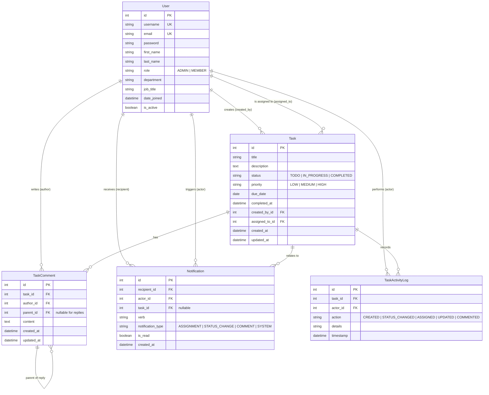

# TaskFlow - Database Design & Schema Specification

## 1. Entity-Relationship Overview
The TaskFlow data model is designed according to Third Normal Form (3NF) principles, balancing relational integrity with performance efficiency for frequent task queries and status aggregation.

---

## 2. Table Specifications

### 2.1 Table: `accounts_user` (Custom User Model)
| Column Name | Type | Modifiers / Constraints | Description |
| :--- | :--- | :--- | :--- |
| `id` | BigAutoField | Primary Key, Auto Increment | Unique Identifier |
| `username` | VarChar(150) | Unique, Not Null | System username |
| `email` | VarChar(254) | Unique, Not Null | Corporate email address |
| `password` | VarChar(128) | Not Null | Hashed PBKDF2 password |
| `first_name`| VarChar(150) | Nullable | Given name |
| `last_name` | VarChar(150) | Nullable | Family name |
| `role` | VarChar(20) | Choices: `ADMIN`, `MEMBER`, Default: `MEMBER` | Role-Based Access Control |
| `department`| VarChar(100) | Nullable | Department (Engineering, Marketing, etc.) |
| `job_title` | VarChar(100) | Nullable | Title (Lead Developer, QA, Designer) |
| `is_active` | Boolean | Default: True | Soft deletion / account state |
| `date_joined`| DateTime | Auto-now-add | Timestamp of registration |

### 2.2 Table: `tasks_task`
| Column Name | Type | Modifiers / Constraints | Description |
| :--- | :--- | :--- | :--- |
| `id` | BigAutoField | Primary Key, Auto Increment | Task Unique ID |
| `title` | VarChar(255) | Not Null, Index | Descriptive title |
| `description`| TextField | Nullable | Markdown-supported body |
| `status` | VarChar(20) | Choices: `TODO`, `IN_PROGRESS`, `COMPLETED`, Index | Current workflow state |
| `priority` | VarChar(20) | Choices: `LOW`, `MEDIUM`, `HIGH`, Index | Priority urgency level |
| `due_date` | Date | Nullable, Index | Target completion date |
| `completed_at`| DateTime | Nullable | Timestamp when moved to COMPLETED |
| `created_by_id`| BigInt | FK -> `accounts_user.id`, ON DELETE SET_NULL | Task author |
| `assigned_to_id`| BigInt| FK -> `accounts_user.id`, ON DELETE SET_NULL, Index | Designated assignee |
| `created_at` | DateTime | Auto-now-add, Index | Creation timestamp |
| `updated_at` | DateTime | Auto-now | Last modification timestamp |

### 2.3 Table: `tasks_taskcomment`
| Column Name | Type | Modifiers / Constraints | Description |
| :--- | :--- | :--- | :--- |
| `id` | BigAutoField | Primary Key, Auto Increment | Comment ID |
| `task_id` | BigInt | FK -> `tasks_task.id`, ON DELETE CASCADE | Associated task |
| `author_id` | BigInt | FK -> `accounts_user.id`, ON DELETE CASCADE | Comment creator |
| `parent_id` | BigInt | FK -> `tasks_taskcomment.id`, ON DELETE CASCADE, Nullable | Thread parent for replies |
| `content` | TextField | Not Null | Markdown / text commentary |
| `created_at` | DateTime | Auto-now-add | Timestamp of posting |
| `updated_at` | DateTime | Auto-now | Timestamp of edit |

### 2.4 Table: `tasks_taskactivitylog`
| Column Name | Type | Modifiers / Constraints | Description |
| :--- | :--- | :--- | :--- |
| `id` | BigAutoField | Primary Key, Auto Increment | Audit log ID |
| `task_id` | BigInt | FK -> `tasks_task.id`, ON DELETE CASCADE | Associated task |
| `actor_id` | BigInt | FK -> `accounts_user.id`, ON DELETE SET_NULL, Nullable | User executing event |
| `action` | VarChar(50) | Not Null | Event type (e.g., status_change) |
| `details` | TextField | Nullable | Human-readable log details |
| `timestamp` | DateTime | Auto-now-add | Audit timestamp |

### 2.5 Table: `notifications_notification`
| Column Name | Type | Modifiers / Constraints | Description |
| :--- | :--- | :--- | :--- |
| `id` | BigAutoField | Primary Key, Auto Increment | Notification ID |
| `recipient_id`| BigInt | FK -> `accounts_user.id`, ON DELETE CASCADE, Index | User receiving alert |
| `actor_id` | BigInt | FK -> `accounts_user.id`, ON DELETE SET_NULL, Nullable | User who performed action |
| `task_id` | BigInt | FK -> `tasks_task.id`, ON DELETE CASCADE, Nullable | Related task |
| `verb` | VarChar(255) | Not Null | Short notification message |
| `notification_type`| VarChar(50)| Choices: `ASSIGNMENT`, `STATUS`, `COMMENT`, etc. | Category |
| `is_read` | Boolean | Default: False, Index | Read indicator |
| `created_at` | DateTime | Auto-now-add, Index | Trigger timestamp |

---

## 3. Database Indexes & Query Optimizations
- **Compound index on `(status, assigned_to_id)`:** Accelerates user workload filters and personal Kanban queries.
- **Index on `due_date`:** Accelerates overdue task queries (`WHERE due_date < TODAY AND status != 'COMPLETED'`).
- **Index on `(recipient_id, is_read)`:** Accelerates notification count queries for top navbar badge without table scans.
